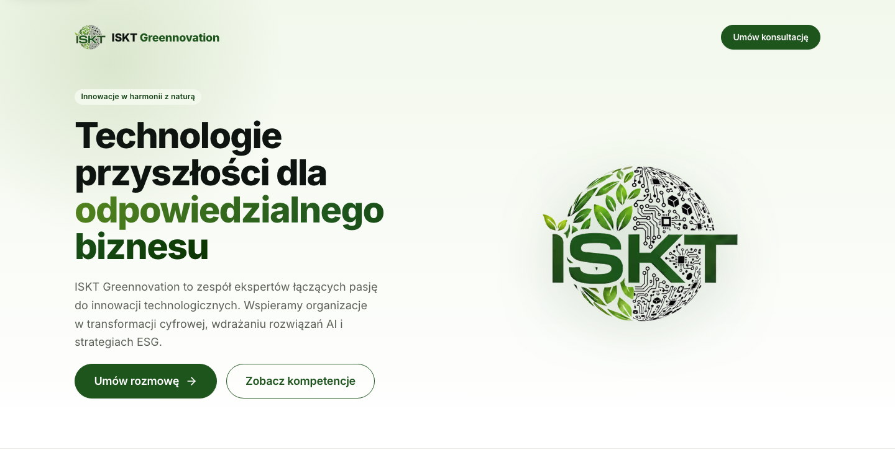

# Raport T-41: Odbiór: nagłówek strony głównej niezgodny z designem (belka i link Kompetencje)

Issue: #41
PR: #42

## Co zrobiono

Przyczyna: wariant home nagłówka miał własne tło `--gradient-wash` (gradient od `--green-50` do bieli
na ok. 80 px), a hero zaczynał ten sam gradient od nowa pod nim. Na styku był skok koloru, który
wyglądał jak jaśniejsza belka z dolną krawędzią. Poświata hero kończyła się też na górnej krawędzi
hero zamiast obejmować nagłówek. Do tego nagłówek zawsze renderował „Kompetencje”.

- **Wariant home bez tła i krawędzi, tło hero płynnie pod nagłówkiem (375, 768, 1440 px).**
  `SiteHeader.astro`: wariant home ma `position: absolute` na górze strony, `background: transparent`
  i nie ma obramowania. `HomeHero.astro` rezerwuje nad treścią `--space-10` + wysokość nagłówka +
  `--space-16`, tak jak sekcja `#top` we wzorcu (`ISKT-standalone.dc.html:54-66`), więc gradient i
  poświata hero leżą pod nagłówkiem. Test: `e2e/home.spec.ts` „nagłówek home przy {375,768,1440} px:
  przezroczysty, nałożony na hero jak we wzorcu” (tło `rgba(0,0,0,0)`, brak `background-image`,
  krawędź 0 px, hero zaczyna się na y = 0).
- **Wariant home ma po prawej tylko „Umów konsultację” (→ /#kontakt); wymiary jak we wzorcu.**
  Link „Kompetencje” renderuje się tylko w wariancie page. CTA w home ma 40 px wysokości i padding
  `0 1.15rem` jak we wzorcu (l. 63), logo 40 px. Nagłówek jest 40 px od góry, a siatka hero zaczyna
  się 64 px pod nim. Poniżej 520 px CTA przechodzi do drugiego rzędu pod logo, z odstępem 16 px, jak
  `flex-wrap` we wzorcu. Testy: `SiteHeader.test.ts` „wariant home ma po prawej wyłącznie…”,
  `e2e/home.spec.ts` „nagłówek home: logo i wyłącznie…” oraz test geometrii przy 3 szerokościach
  (położenie logo i CTA, odstępy 40 i 64 px, wysokości 40 px).
- **Wariant page bez zmian.** Style i znaczniki wariantu page są takie same jak przed zmianą.
  Testy: `SiteHeader.test.ts` „wariant page ma „Kompetencje” i CTA” oraz dotychczasowe testy
  `aria-current="true"` (W-02). `e2e/layout.spec.ts` sprawdza „Kompetencje” → `/#kompetencje` na 404,
  a testy stron usług sprawdzają je na swoich stronach. Wszystkie są zielone.
- **`<header>` poza `<main>`, SkipLink, axe, Lighthouse.** Kolejność DOM się nie zmieniła
  (`e2e/layout.spec.ts`: SkipLink, HEADER, MAIN, FOOTER). Testy SkipLink i axe (serious/critical) są
  zielone na `/` w chromium i webkit. Lighthouse: nie zmierzony lokalnie (szczegóły w „Testach”
  i „Ryzykach”).
- **Testy zaktualizowane i zrzut porównawczy.** `e2e/layout.spec.ts`: na `/` „Kompetencje” ma
  liczbę 0, na pozostałych stronach link jest obecny. Zrzuty (chromium, viewport ×760) zbudowanej
  strony i wzorca:

| Szerokość | Strona (po zmianie) | Wzorzec |
|---|---|---|
| 375 px |  |  |
| 768 px |  |  |
| 1440 px |  |  |

Nagłówek pokrywa się ze wzorcem przy każdej szerokości: położenie logo i CTA, brak belki, ciągły
gradient i poświata.

## Testy

- `pnpm lint`: zielone (ESLint + Prettier).
- `pnpm typecheck`: 0 błędów, 0 ostrzeżeń.
- `pnpm test`: zielone, 11 plików, 131 testów.
- `pnpm test:e2e` (pełny zestaw, chromium + webkit): 534 passed, 2 skipped. Po czerwonym CI
  uruchomiony ponownie lokalnie: znowu 534 passed, 2 skipped.
- CI PR #42, run 42217548258, job e2e: czerwony, ale nie przez kod zadania. Log pokazuje, że krok
  „Przeglądarki Playwright (chromium + webkit)” instalował zależności systemowe przez apt z
  `azure.archive.ubuntu.com` w tempie 20–60 s na pakiet, z kilkoma `Ign:` (timeout pobierania).
  Job przekroczył limit 20 min („The job has exceeded the maximum execution time of 20m0s”). Krok
  „Testy E2E” w ogóle nie wystartował. Lint, test, check-dod i gitleaks w tym samym runie są
  zielone. W kodzie i testach zadania nie było czego naprawiać. Push z tą poprawką raportu
  uruchamia CI ponownie.
- Lighthouse (`pnpm lh:staging` na lokalnym buildzie): brak wyniku. Pierwszy przebieg przerwało
  równoległe `pnpm test:e2e`, bo Playwright wyczyścił `test-results/`. Drugi przebieg zatrzymałem
  po limicie czasu. Wynik ≥ 90 dla `/` (mobile i desktop) sprawdzi QA albo CI na stagingu. Zmiana
  dotyczy tylko CSS nagłówka i hero oraz usunięcia jednego linku. Element LCP (logo hero) i jego
  `sizes` się nie zmieniły.

## Decyzje

- Jak nałożyć nagłówek na hero, skoro `<header>` musi być poza `<main>`, a hero jest w `<main>`? →
  Wariant home ma `position: absolute`, a hero rezerwuje miejsce przez `padding-top`. Alternatywy
  odrzuciłem: `display: contents` na `<main>` ryzykuje utratę landmarku, a tło na `<body>` wymaga
  znajomości wysokości hero.
- Jak zarezerwować wysokość nagłówka bez JavaScriptu (CSP)? → Wysokość jest stała w zmiennej
  `--site-header-home-h`: 40 px, a poniżej 520 px dwa rzędy po 40 px + 16 px. Rzędy mają stałą
  wysokość, a zawijanie CTA wymusza `flex-direction: column` poniżej progu. Próg 520 px to szerokość,
  przy której logo z nazwą i CTA mieszczą się w jednym rzędzie (≈430 px + marginesy). Wzorzec
  zawija przez `flex-wrap`, więc przy 430-520 px u nas CTA przechodzi do drugiego rzędu nieco
  wcześniej. Przy 375, 768 i 1440 px układ jest zgodny.
- Plik spoza „Zakresu”: zrzuty w `docs/07-realizacja/T-41/*.png` → wymaga ich kryterium „zrzut
  porównawczy z wzorcem w raporcie”. Zrobiłem je skryptem tymczasowym (Playwright chromium,
  zbudowane `dist/client` serwowane statycznie), skryptu nie commituję.
- Dodatkowo przeczytane źródła: `docs/02-design/zrodla/Strona firmowa ISKT/ISKT-standalone.dc.html`
  (wzorzec z issue), `src/layouts/BaseLayout.astro`, `src/components/ui/Button.astro`,
  `playwright.config.ts`, `lighthouserc.cjs`. Bez zmian.

## Drobne uwagi

- Przyciski hero „Umów rozmowę” i „Zobacz kompetencje” mają poniżej 480 px pełną szerokość, a we
  wzorcu zachowują szerokość treści (widać na zrzucie 375 px). To wcześniejsza decyzja spoza zakresu
  tego zadania.

## Ryzyka

- Wysokość nagłówka home jest stała. Dłuższa nazwa w logo albo większa czcionka systemowa (zoom
  tekstu) może sprawić, że treść nagłówka nie zmieści się w rzędzie 40 px. Wtedy nagłówek nachodzi
  na hero, a nie rozpycha go.
- Gdy ponowny run CI też przekroczy limit na instalacji przeglądarek, zielone E2E w CI zależy od
  ponownego uruchomienia albo poprawki CI. Decyduje orkiestrator.
- Kryterium „Lighthouse strony głównej mobile i desktop ≥ 90” nie jest sprawdzone w tym zadaniu,
  bo lokalny pomiar nie zakończył się w limicie czasu. QA albo CI powinno to sprawdzić na stagingu:
  `pnpm lh:staging <adres>`.

## Propozycje dla systemu

- `astro preview` nie działa z adapterem Vercel, a profil workera blokuje polecenia z prefiksem
  zmiennych środowiskowych (`ASTRO_ADAPTER=node pnpm preview`). Do zrzutów i Lighthouse trzeba było
  napisać tymczasowy serwer statyczny. Propozycja: skrypt `pnpm preview:local` (adapter node, port
  55327) w szablonie projektu Astro + Vercel.
- Job e2e w CI może przekroczyć limit 20 min, gdy mirror apt jest wolny, bo
  `playwright install --with-deps` instaluje zależności systemowe przy każdym runie. Propozycja:
  cache przeglądarek Playwright (`~/.cache/ms-playwright`) albo obraz/kontener
  `mcr.microsoft.com/playwright` w CI. To zmiana CI, poza zakresem workera.
- Równoległe `pnpm test:e2e` i `pnpm lh:staging` kolidują, bo Playwright czyści `test-results/`,
  a lhci trzyma tam `.lighthouseci/`. Propozycja: katalog roboczy lhci poza `test-results/`.
